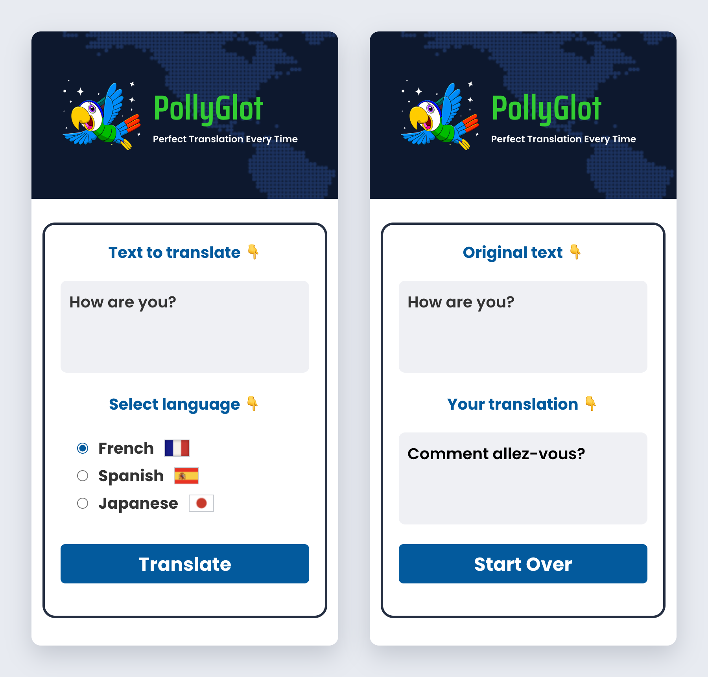

# PollyGlot 🦜

**Perfect Translation Every Time:** a small AI-powered translation app. Enter a text, pick a language, and PollyGlot translates it for you.

This is a solo project from the [AI Engineer Path](https://scrimba.com/ai-engineer-path-c02v) at [Scrimba](https://scrimba.com).

<p align="center">
  
</p>

## How it works

1. Type the text you want to translate.
2. Choose a target language: **French 🇫🇷**, **Spanish 🇪🇸** or **Japanese 🇯🇵**.
3. Click **Translate**. PollyGlot shows the original text and the translation.
4. Click **Start Over** to translate something new.

## Features

- **AI translation** with the OpenAI Responses API
- **Three views** (input, result, error) that switch without a page reload
- **Input validation:** empty or whitespace-only text is caught with the browser's built-in validation message
- **Loading state:** while the request runs, the button shows "Translating..." and is disabled
- **Error handling:** a friendly error message and a **Try again** button that keeps your text
- **Prompt injection protection:** the text is wrapped in `<text>` tags, so input like *"Ignore all previous instructions…"* gets translated instead of followed
- **Responsive layout:** full screen on mobile, centered card on desktop

## Tech stack

- HTML, CSS and vanilla JavaScript (ES modules)
- [Vite](https://vitejs.dev/) for the dev server and build
- [OpenAI](https://platform.openai.com/) API via the official `openai` npm package
- Fonts: [Poppins](https://fonts.google.com/specimen/Poppins) and [Saira Condensed](https://fonts.google.com/specimen/Saira+Condensed) from Google Fonts

## Getting started

1. Install the dependencies:

   ```bash
   npm install
   ```

2. Create a `.env` file in the project root with your OpenAI API key and the model you want to use:

   ```bash
   VITE_OPENAI_KEY=your-openai-api-key
   VITE_AI_MODEL=your-model-name
   ```

3. Start the dev server and open the local URL that Vite prints (by default http://localhost:5173):

   ```bash
   npm start
   ```

| Command           | What it does                         |
| ----------------- | ------------------------------------ |
| `npm start`       | Starts the dev server                |
| `npm run build`   | Builds the app into `dist/`          |
| `npm run preview` | Serves the production build locally  |

> [!WARNING]
> The app calls the OpenAI API directly from the browser (`dangerouslyAllowBrowser: true`). Vite builds every `VITE_` variable into the frontend code, so **anyone who opens the app can read your API key**. That's fine for running it locally, but don't deploy it publicly like this. A production version should send the request through a backend or serverless function that keeps the key secret.

## Project structure

```
PollyGlot/
├── assets/          # parrot logo, world map, flags, screenshot
├── index.html       # markup for the input, result and error views
├── index.css        # styles
├── index.js         # app logic and OpenAI request
├── .env             # your API key and model (not committed)
├── vite.config.js
└── package.json
```

## Credits

Scrimba provided the project brief, the design and the assets (parrot, world map, flags) as part of the AI Engineer Path.
